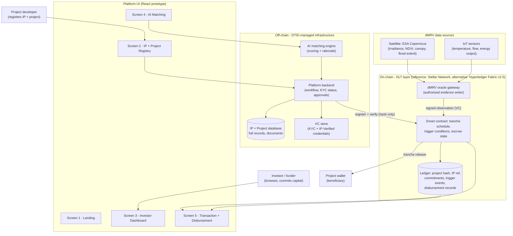
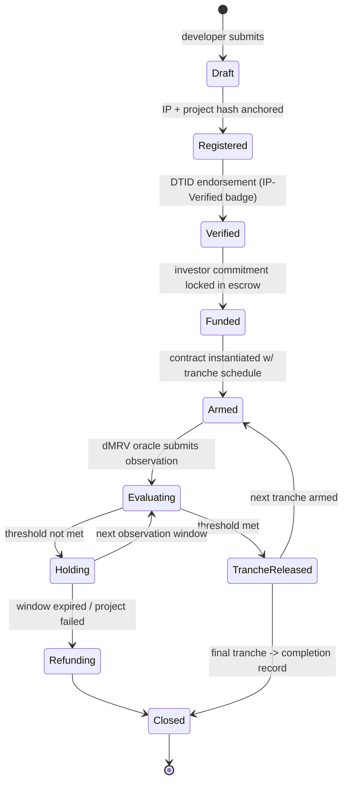

# OL1 — DLT Transaction Flow

**Deliverable:** OL1 — DLT transaction flow design: on-chain lifecycle from project registration to payment
**Project:** GreenImpact Connect — Climate Micro-Finance Platform (COP31 / WIPO prototype)
**Author:** Olvis Gil (STO — DLT Specialist)
**Audience:** Christopher Coccaro (Screen 5 build), Onder Altan and Sak Viswanathan (review)
**Date:** 24 October 2026
**Status:** For peer review — feeds Screen 5 (Transaction & Disbursement) of the MVP deck v2

---

## 1. Purpose and scope

This document defines the distributed ledger transaction flow that the COP31 prototype simulates on **Screen 5 (Transaction and Disbursement)**. It describes the full on-chain lifecycle — from project and IP registration through investor commitment, dMRV-triggered evaluation, and tranche disbursement — so that Christopher can render a technically credible mock of the ledger record and disbursement event.

This is a **simulated** flow for the prototype. No live blockchain backend exists for the MVP; the design below is what the production platform would execute and what the demo must faithfully represent.

## 2. Design principles

1. **Two candidate ledgers under evaluation.** The reference implementation in the current demo renders **Stellar Network** (public, with Soroban smart contracts and native USDC). **Hyperledger Fabric v2.5** (permissioned) is retained as the comparison candidate. Selection criteria in §8; the lifecycle and data model are identical on either.
2. **DLT as an accountability layer, not a prerequisite.** Per domain guidance, the platform must be presented as DLT-optional and technology-neutral. The ledger provides immutable audit, conditional disbursement, and transparency — the matchmaking platform works without it. Screen 5 demonstrates the value-add of the DLT option.
3. **On-chain hashes, off-chain data.** Only commitments, proofs, state transitions, and value transfers are written to the ledger. Project documents, personal data, and full project records remain in the DTID-managed database; the chain stores content hashes so any off-chain record can be proven unaltered.
4. **Mock but technically formatted.** Every value shown in the demo (transaction hash, block number, timestamp, wallet identifiers) must be plausible and internally consistent — WIPO will evaluate realism, not the algorithm.
5. **Results-based payment.** Funds move only when independently verified data confirms a milestone. The smart contract encodes the condition; the dMRV oracle supplies the evidence.
6. **DID/VC identity layer.** Actors are identified by W3C Decentralised Identifiers (DIDs); attestations — KYC, IP-Verified status, oracle evidence — are W3C Verifiable Credentials held off-chain. Only the credential's content hash is anchored on-chain (principle 3), so any credential can be proven unaltered without exposing its contents.

## 3. Actors

| Actor | Role in the flow | Identity (DID / on-chain account) |
|---|---|---|
| **Project developer** | Registers project + IP; receives tranche disbursements | DID (e.g. `did:web:nbwcoop.example`) holding KYC + IP-Verified VCs; Stellar account `GNBWCOOP3XR7KT2VF9ALMQWESH4BDY8NUJ6CZP5GE1TAO` is the payment leg |
| **DTID platform operator** | Verifies projects, issues endorsements + credentials, operates validator + contract infrastructure, governs contract deployment | Issuer DID `did:web:dtid.ngo` (issues KYC + IP-Verified VCs); operates `GDTID7KQ4XM2VP9ARCFNLWEHB3SJY6TUD5GZO8CPX1MEQ` — the DTID Climate Finance Contract identity |
| **Investor / funder** | Commits capital into escrow against a project's tranche schedule | DID bound to investor Stellar account; accreditation/KYC VC on file; commitment record on chain |
| **dMRV oracle** | Publishes verified observation data (satellite/IoT) to the ledger; the sole authorised writer of trigger evidence | Issuer DID `did:web:dmrv.dtid.ngo` — each observation signed as a VC (Data Integrity proof); oracle account is the authorised on-chain writer |
| **SCP validators** | DTID + partner-run validator nodes that confirm each ledger via the Stellar Consensus Protocol | Validator node identities in the quorum set |

*DIDs and VCs live off-chain; only credential content hashes are anchored to the ledger (§6).*

## 4. Architecture



**Boundary rule:** everything above the chain boundary is conventional infrastructure the prototype actually runs; everything below is simulated with technically formatted mock records on Screen 5.

## 5. On-chain lifecycle



### Stage detail

| # | Stage | What happens on-chain | Off-chain counterpart |
|---|---|---|---|
| 1 | **Project + IP registration** | `registerProject(ipRef, projectHash, credentialHash)` writes the IP reference, a SHA-256 hash of the project record, and the hash of the developer's credentials. Creates the immutable anchor for everything after. | Full project record + IP documents in DTID database; developer KYC + IP credentials held as VCs |
| 2 | **DTID verification** | `endorseProject(projectId)` — a signed transaction from the authorised DTID platform identity flips status to `VERIFIED`, and DTID issues the **IP-Verified Verifiable Credential** to the project DID (issuer `did:web:dtid.ngo`). The VC is what the "IP Verified" badge on Screen 2 represents. | Human/AI-assisted due-diligence review in the platform backend |
| 3 | **Contract instantiation** | A disbursement Soroban contract instance is deployed per funded project: contract ID (`SC-KE-2026-0041`), tranche schedule (count, amounts), trigger conditions (data source, metric, threshold, window), beneficiary account. | Tranche schedule agreed between investor, developer, DTID |
| 4 | **Investor commitment** | `commitFunds(contractId, amount)` locks the pledged capital in the contract's escrow state. Funds cannot leave except via trigger or refund path. | Investor agreement, funding source confirmation |
| 5 | **dMRV evidence submission** | The oracle publishes a signed observation in VC format (Data Integrity proof, issuer `did:web:dmrv.dtid.ngo`): data source, metric, value, window, timestamp. Only the authorised oracle identity may write evidence — the contract rejects anything else. | ESA Copernicus imagery pipeline / IoT sensor network feeding the oracle |
| 6 | **Trigger evaluation** | Contract checks evidence against the stored condition: `value >= threshold` within the window. Emits a `TriggerEvent` either way — met or not met is both recorded. | Evaluation rules defined in OL2 (per project type) |
| 7 | **Tranche release** | On `THRESHOLD MET`: `releaseTranche(n)` transfers the tranche amount (USDC-denominated) from escrow to the beneficiary wallet; writes the disbursement record immutably. | Payment notification; developer sees release on platform |
| 8 | **Record + audit trail** | Every transition above is a ledger transaction: hash, block, timestamp, counterparties. Screen 5 renders this record verbatim. | Audit export for funders / regulators |

### Failure and exception paths

- **Threshold not met:** contract stays in `Holding`; the observation and result are recorded for transparency. Next window re-arms evaluation.
- **Window expired / project failed:** remaining escrow returns to the investor via `refund()` — capital is never stranded.
- **Oracle dispute:** DTID governance (multi-sig of endorsing orgs) can pause a contract pending evidence review; override events are themselves on-chain and auditable.

## 6. Data model — on-chain vs off-chain

| Data | Location | Why |
|---|---|---|
| IP reference number, type, country | On-chain (as registered fields) + off-chain | Public verifiability of the IP-Verified claim |
| Full project record, documents, personal data | Off-chain (hash on-chain) | GDPR, confidentiality, storage cost |
| Smart contract state: tranche schedule, thresholds, escrow balance | On-chain | Conditional logic must be tamper-proof |
| dMRV observations (source, metric, value, window) | On-chain (signed by oracle); raw imagery/sensor payloads off-chain | Evidence must be immutable; payloads are large |
| Disbursement record (amount, wallets, tx, block) | On-chain | The audit trail is the product's core claim |
| DIDs + VCs (KYC, IP-Verified, oracle attestations) | Off-chain; credential hash anchored on-chain | Credentials stay portable and private; the hash proves they are unaltered |
| AI match scores, rationale text | Off-chain | Advisory data; not part of the financial record |

## 7. Mock ledger record — what Screen 5 renders

Christopher: this is the record the screen must display after "Execute release". Values below are the canonical mock values — reuse them verbatim so the deck, the demo, and this document all agree. The demo renders the **Stellar Network** format.

```json
{
  "txHash": "9f3ac8e21b7d4f06a5c1e8b2d7f4a9c3e6b1d8f5a2c7e4b9d1f6a3c8e5b2d7f4a9c1",
  "ledger": 52847119,
  "status": "SUCCESS",
  "timestamp": "2026-11-03T13:42:17Z",
  "sourceAccount": "GDTID7KQ4XM2VP9ARCFNLWEHB3SJY6TUD5GZO8CPX1MEQ",
  "destination": "GNBWCOOP3XR7KT2VF9ALMQWESH4BDY8NUJ6CZP5GE1TAO",
  "amount": "18750.0000000",
  "asset": "USDC (issued, Circle anchor)",
  "operation": "payment",
  "contract": "SC-KE-2026-0041",
  "ipRef": "KE-2026-0041",
  "ipCredential": {
    "type": "VerifiableCredential",
    "issuer": "did:web:dtid.ngo",
    "subject": "did:web:nbwcoop.example",
    "claim": "IP-Verified",
    "vcHash": "7f3ac9e21b8d4f06a5c1e8b2d7f4a9c3e6b1d8f5a2c7e4b9d1f6a3c8e5b2d7f4a9"
  },
  "tranche": { "index": 2, "of": 4 },
  "trigger": {
    "source": "ESA Copernicus satellite observation",
    "metric": "solar_irradiance_kwh_m2_day",
    "threshold": 5.2,
    "oracleAttestation": "VC Data Integrity proof — issuer did:web:dmrv.dtid.ngo",
    "result": "THRESHOLD MET"
  },
  "network": "Stellar Network (Soroban smart contract, public)"
}
```

**Hyperledger Fabric variant (alternative render).** If Screen 5 is switched to the permissioned candidate, the same event renders in Fabric's format — note the different address/hash/block conventions:

```json
{
  "txHash": "0x3f7a9c2b1d4e8a0f5c6e2b3d9f1a4c7e8b2d5f0a1c3e6a9b2d4f7c0e3a6b9d2f",
  "block": 14872441,
  "confirmations": 3,
  "status": "Confirmed",
  "timestamp": "2026-11-03T13:42:17Z",
  "from": {
    "wallet": "0xDTID_PlatformWallet",
    "label": "DTID Climate Finance Contract"
  },
  "to": {
    "wallet": "0xNBWCoop_Wallet",
    "label": "Nairobi West Cooperative"
  },
  "value": { "amount": 18750.00, "currency": "USDC", "fiat": "USD 18,750" },
  "contract": "SC-KE-2026-0041",
  "ipRef": "KE-2026-0041",
  "ipCredential": {
    "type": "VerifiableCredential",
    "issuer": "did:web:dtid.ngo",
    "subject": "did:web:nbwcoop.example",
    "claim": "IP-Verified",
    "vcHash": "7f3ac9e21b8d4f06a5c1e8b2d7f4a9c3e6b1d8f5a2c7e4b9d1f6a3c8e5b2d7f4a9"
  },
  "tranche": { "index": 2, "of": 4 },
  "trigger": {
    "source": "ESA Copernicus satellite observation",
    "metric": "solar_irradiance_kwh_m2_day",
    "threshold": 5.2,
    "observed": ">= 5.2",
    "window": "30-day observation ending 3 Nov 2026",
    "oracleAttestation": "VC Data Integrity proof — issuer did:web:dmrv.dtid.ngo",
    "result": "THRESHOLD MET"
  },
  "network": "Hyperledger Fabric v2.5 (Permissioned)"
}
```

Format notes for the UI:

- **txHash:** 64-char hex string, **no `0x` prefix** (Stellar convention) — display truncated with copy affordance if desired.
- **Ledger:** Stellar closes a numbered ledger roughly every 5 seconds; `ledger` plays the role "block number" does on other chains — render as `Ledger #52,847,119`.
- **Tranche:** render as `Tranche 2 of 4` (deck wording) from `index`/`of`.
- **Timestamp:** ISO 8601 UTC; render as `2026-11-03 13:42:17 UTC` per the deck.
- **Status/finality:** Stellar finality is deterministic — a transaction is either `SUCCESS` or it was never committed; there is no confirmations counter. Render `SUCCESS` alongside the ledger number.
- **Addresses:** Stellar public keys are long base32-style strings starting with `G` — display truncated (`GDTID7…X1MEQ`) with copy affordance.
- **Credentials:** `ipCredential` renders as the detail behind the "IP-Verified VC" badge (issuer DID + claim); `trigger.oracleAttestation` is the signed-evidence line. DIDs display truncated like addresses (`did:web:dtid.ngo` is short enough to show in full).
- **Deck alignment:** the MVP deck v2 Screen 5 mock was drawn in the Fabric format (`0x` hash, block number, "3 confirmations") — it must be re-rendered to the Stellar layout above so deck, demo, and docs agree (see §9).
- The flow above the record: dMRV trigger panel → smart contract execution panel → ledger record panel, in that order.

## 8. Candidate ledgers — Stellar Network (reference) and Hyperledger Fabric v2.5 (comparison)

Two ledgers are under evaluation. **Stellar Network is the reference implementation rendered on Screen 5**; Hyperledger Fabric v2.5 is retained as the comparison candidate. Both satisfy the hard requirements (no proof-of-work, deterministic finality, conditional disbursement, auditable records); they differ in where they sit on the public ↔ private spectrum.

| Criterion | Stellar Network (public, Soroban) — reference | Hyperledger Fabric v2.5 (permissioned) — comparison |
|---|---|---|
| **Network type** | Public network — anyone can transact; consensus via Stellar Consensus Protocol (federated Byzantine agreement, no mining) | Private consortium chain — validators are known institutions (DTID, funders, verification bodies) |
| **Smart contracts** | Soroban contracts (Rust → WASM); newer but purpose-built for financial logic | Chaincode (Go/JS/Java); full application logic |
| **Payments** | Native asset model — USDC is issued directly on Stellar (Circle anchor); built-in payment operations | Value moves via tokens/stablecoins represented on the ledger |
| **Transaction cost** | ~fractions of a US cent per transaction — negligible at micro-finance tranche sizes | Effectively zero (infrastructure cost only) |
| **Finality** | Deterministic; ledger closes ~5 seconds | Deterministic on commit |
| **Confidentiality** | Public ledger — confidentiality via off-chain data + on-chain hashes only | Private channels keep project terms visible only to entitled parties |
| **Audit / regulator access** | Anyone can verify on-chain; no special access needed | Auditors join the channel; read without write rights |
| **Fits which story** | "Open, globally accessible payment rail where any donor can verify disbursement" | "Institutional-grade, governed, confidential climate finance rail" |
| **Key caveat** | Public-association optics; Soroban ecosystem younger than chaincode | Requires operated infrastructure (peers, ordering service) |

**Working recommendation for the prototype:** render **Stellar** as the format on Screen 5 — native USDC issuance, built-in payment operations, ~5-second deterministic finality, and public verifiability are the strongest possible answer if WIPO asks "how would a donor in another country verify the money arrived?". Keep **Fabric** in the narrative as the governed, confidential alternative for institutions that require private channels over commercially sensitive project terms. A post-MVP hybrid is credible: Stellar as the open payment/disbursement rail, Fabric channels for confidential records where partners require them.

**Shared justification (either candidate):** no proof-of-work mining → negligible per-transaction energy → defensible for a climate finance platform; deterministic finality → no reorg ambiguity in the disbursement record; both support the exact trigger/tranche logic defined in OL2.

Framing line for the demo: *"The platform is ledger-agnostic; the demo runs on Stellar — a public, energy-efficient network where any donor can verify the disbursement — and we retain a permissioned option (Hyperledger Fabric) for partners who require confidential channels. In both cases, accountability and energy efficiency are requirements, not preferences."*

## 9. Open items for build

- **Deck alignment:** MVP deck v2's Screen 5 mock was drawn in the Fabric record format (`0x` hash, block number, "3 confirmations"). Re-render it to the Stellar layout in §7 (ledger number, `G…` addresses, `SUCCESS` status) so the deck, demo, and OL docs agree.
- Screen 5 needs one "disputed/not met" state for completeness — the deck only shows the success path; recommend a toggle or a second example in reviewer notes (see OL2 for fail-path definitions).
- Confirm with Christopher whether the mock record is hard-coded JSON or generated — either is fine, values above are canonical either way.
- Post-MVP roadmap note (if asked): the architecture supports plugging into WIPO PATENTSCOPE / WIPO Connect for IP verification — the IP-Verified VC is modelled so WIPO itself could later act as the credential issuer — and into public-chain anchoring for external auditability.

---

*DTID Emerging Technology Division — Climate Micro-Finance Platform — CONFIDENTIAL INTERNAL*
