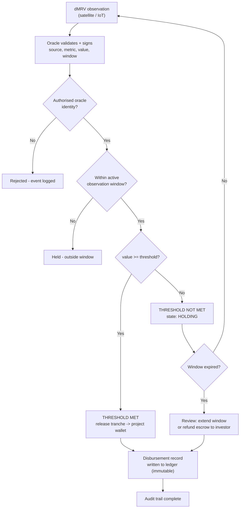

# OL2 — Smart Contract Trigger Conditions

**Deliverable:** OL2 — Smart contract trigger condition definitions with worked examples
**Project:** GreenImpact Connect — Climate Micro-Finance Platform (COP31 / WIPO prototype)
**Author:** Olvis Gil (STO — DLT Specialist)
**Audience:** Christopher Coccaro (Screen 5 build), Onder Altan and Sak Viswanathan (review)
**Date:** 24 October 2026
**Companion document:** OL1 — DLT Transaction Flow (lifecycle, architecture, ledger record format)
**Status:** For peer review — defines the trigger logic displayed on Screen 5

---

## 1. What a trigger condition is

A trigger condition is the contract-encoded rule that converts **verified real-world evidence into a payment decision**. The platform disburses capital in tranches on a results-based payment (RBP) basis: money moves when a dMRV (digital Measurement, Reporting, Verification) observation proves a milestone — not on promises, not on elapsed time.

Every trigger condition has six components:

| Component | Meaning | Example |
|---|---|---|
| **Data source** | The authoritative dMRV feed | ESA Copernicus satellite; calibrated IoT sensor array |
| **Metric** | The physical quantity measured | Solar irradiance; storage temperature; canopy cover (NDVI) |
| **Threshold** | The pass/fail boundary | `>= 5.2 kWh/m²/day` |
| **Window** | The observation period the metric is evaluated over | 30 days; 60 days; 6 months post-planting |
| **Verification** | Who attests the reading is authentic | Signed oracle VC (Data Integrity proof, issuer `did:web:dmrv.dtid.ngo`); DTID-issued IP-Verified credential on file |
| **Tranche action** | What the contract does on pass | Release tranche *n* of *m*, amount in USDC, to beneficiary wallet |

Contract form (simplified pseudocode — what the Screen 5 contract panel is *saying* it executed):

```
on oracleObservation(metric, value, window):
    require(msg.sender == authorisedOracle)
    require(state == ARMED)
    if value >= threshold[metric] and window == activeWindow:
        emit TriggerEvent(metric, value, MET)
        releaseTranche(currentTranche)   // escrow -> beneficiary wallet
        currentTranche += 1 or close()
    else:
        emit TriggerEvent(metric, value, NOT_MET)
        state = HOLDING                  // funds stay locked; next window scheduled
```

## 2. Trigger evaluation flow



## 3. Worked example 1 — Community Solar, Nairobi West (Kenya)

*This is the anchor example — it is exactly what Screen 5 displays in the MVP deck. Use these values verbatim.*

| Field | Value |
|---|---|
| Project | Community Solar — Nairobi West |
| IP reference | `KE-2026-0041` |
| IP credential | IP-Verified VC — issuer `did:web:dtid.ngo`, subject `did:web:nbwcoop.example`, claim `IP-Verified: KE-2026-0041` |
| Contract | `SC-KE-2026-0041` |
| Beneficiary | `GNBWCOOP3XR7KT2VF9ALMQWESH4BDY8NUJ6CZP5GE1TAO` — Nairobi West Cooperative |
| Data source | ESA Copernicus satellite observation |
| Metric | Solar irradiance (kWh/m²/day) |
| Threshold | `>= 5.2 kWh/m²/day` |
| Window | 30-day observation ending 3 Nov 2026 |
| Result | **THRESHOLD MET** |
| Tranche action | Release **Tranche 2 of 4** — **USD 18,750 (18,750.00 USDC)** |
| Ledger record | `GDTID7KQ4XM2VP9ARCFNLWEHB3SJY6TUD5GZO8CPX1MEQ` → `GNBWCOOP3XR7KT2VF9ALMQWESH4BDY8NUJ6CZP5GE1TAO`; tx `9f3ac8e21b7d4f06a5c1e8b2d7f4a9c3e6b1d8f5a2c7e4b9d1f6a3c8e5b2d7f4a9c1`, ledger `#52,847,119`, `2026-11-03 13:42:17 UTC`, status SUCCESS, Stellar Network (Soroban smart contract, public). Hyperledger Fabric-formatted variant available — see OL1 §7 |

**Why irradiance gates payment:** the tranche pays for verified *generation capacity* — sustained irradiance at the site confirms the installation is exposed and operational as designed. If the array were shaded, damaged, or not installed, the observed irradiance-to-output relationship would fail the threshold and the contract holds funds.

**Total funding context:** USD 75,000 across 4 tranches — T1 on installation sign-off, T2 on this irradiance milestone, T3 on 90-day output continuity, T4 on independent completion audit.

## 4. Worked example 2 — Solar Cold Chain, Rwanda

| Field | Value |
|---|---|
| Project | Solar-powered cold chain hub — Kigali district |
| IP reference | `RW-2026-0117` (mock) |
| Contract | `SC-RW-2026-0117` (mock) |
| Beneficiary | `GKIGALICOLDCHAINX7Q2WM4TZPERF6VN3HJS9DYU5KABLM2CQ` (mock) — cooperative cold-chain operator |
| Data source | Calibrated IoT temperature sensors in the cold-store units |
| Metric | Percentage of sensor readings within the safe band (2–8 °C) |
| Threshold | `>= 95%` of readings in band |
| Window | Rolling 60 days of continuous operation |
| Tranche action | Release **Tranche 1 of 3** — **USD 22,400 (22,400.00 USDC)** |

**Rationale:** a cold chain's climate value is food-loss avoided — which only materialises if produce is actually kept cold. Uptime evidence from in-unit sensors is the least gameable proxy: 95% in-band compliance proves the equipment works *and* is being operated, not merely delivered.

**Fail path:** 88% compliance recorded in window 1 → `HOLDING`; operator remediates a faulty unit; window 2 re-measures at 96.7% → tranche releases. Good demo line for "what happens when it doesn't pass."

## 5. Worked example 3 — Mangrove Restoration, Philippines

| Field | Value |
|---|---|
| Project | Community mangrove restoration — coastal barangay, Eastern Visayas |
| IP reference | `PH-2026-0063` (mock) |
| Contract | `SC-PH-2026-0063` (mock) |
| Beneficiary | `GMANGROVECOOPPH6XQ8WK2TN4ZP3ERF9VJ5HSDYU7KALBMQ2C` (mock) — community restoration cooperative |
| Data source | Satellite multispectral imagery (ESA Copernicus-class) |
| Metric | NDVI uplift vs. pre-planting baseline, over the planted parcel |
| Threshold | `>= 0.15` NDVI uplift **and** `>= 25 ha` of verified canopy establishment |
| Window | 6 months post-planting |
| Tranche action | Release **Tranche 2 of 3** — **USD 31,000 (31,000.00 USDC)** |

**Rationale:** nature-based projects can't be sensor-verified cheaply at scale; satellite canopy/NDVI change is the standard dMRV proxy for survival and growth. The dual condition (greenness uplift *and* minimum area) prevents passing on a tiny thriving patch while the rest failed.

**Fail path:** NDVI met but only 18 ha established → `NOT MET`, funds hold; DTID review may extend the window one season before any refund decision — nature-based timelines are slower and the contract schedule reflects that.

## 6. Cross-cutting rules

- **Both outcomes are recorded.** A `NOT MET` event is written to the ledger too — the audit trail must show the platform enforced conditions, not just paid out. This is the transparency argument for WIPO.
- **Oracle is the only evidence writer.** Contracts reject unsigned or non-oracle submissions (see flow diagram); every observation is signed as a VC-format attestation (Data Integrity proof), verifiable off-ledger. If the demo is asked "who can fake a reading" — the answer is: nobody with on-chain effect; oracle identity is permissioned and attestable.
- **Money never sits in limbo.** Every contract has a defined end state: all tranches released → `CLOSED`, or expiry/failure → `REFUNDED`. Escrow cannot be stranded.
- **Governance override is visible.** DTID multi-sig can pause for evidence disputes, but the pause itself is an on-chain event — accountability includes the operator.
- **Tranche sizes are illustrative.** Amounts (18,750 / 22,400 / 31,000 USDC) are mock values sized to be plausible for community-scale micro-finance; final sample data per Thomas (Q12).
- **Ledger-agnostic.** The six trigger components and all rules above are identical whether the contract runs as a Stellar Soroban contract (reference) or Fabric chaincode (comparison) — only the on-chain record format differs (OL1 §7 gives both render formats; §8 compares the two candidates).

## 7. Mapping to Screen 5 elements

| Screen 5 panel | Fed by |
|---|---|
| "dMRV trigger event" card | Data source, metric, threshold, window, result badge (EX-1 values) |
| "Smart contract execution" card | Contract ID, trigger condition, tranche index/of-total, amount, beneficiary |
| "Execute release" action → confirmation line | Tranche action + timestamp |
| "Blockchain ledger record" card | OL1 §7 canonical mock record |

---

*DTID Emerging Technology Division — Climate Micro-Finance Platform — CONFIDENTIAL INTERNAL*
